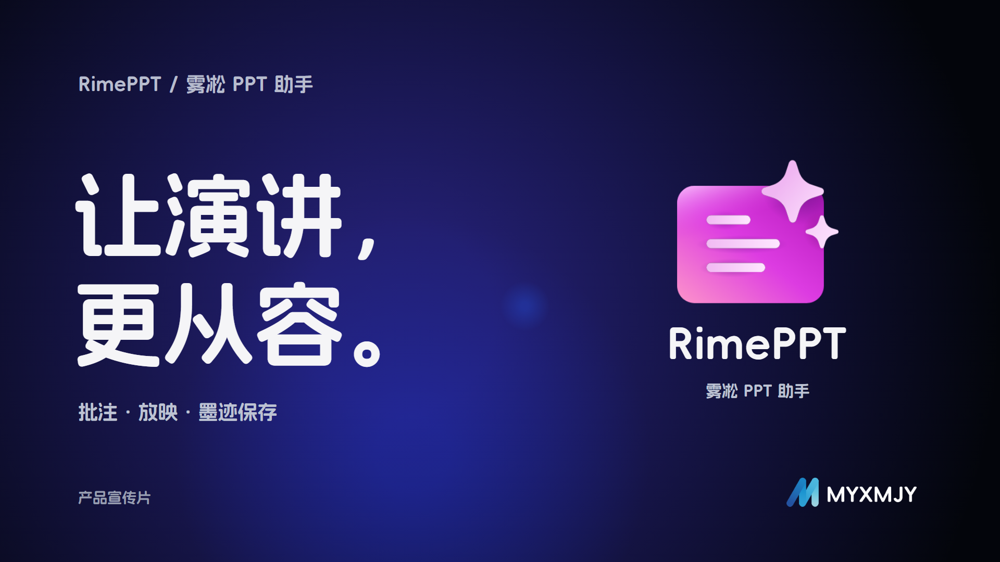

<div align="center">
  
  <h1>RimePPT</h1>
  <p><strong>让翻页、批注与板书，留在课堂演示之中。</strong></p>
  <p>面向 Windows、PowerPoint 与触摸屏的放映助手 · 原生 WinUI 3</p>
  <p>
    <a href="https://RimePPT.MYXMJY.Top">官方网站</a> ·
    <a href="https://apps.microsoft.com/detail/9MV9Q91FTTFZ">Microsoft Store</a> ·
    <a href="https://github.com/WRMYX/RimePPT/releases">下载发布版</a> ·
    <a href="https://github.com/WRMYX/RimePPT/issues">反馈问题</a>
  </p>
  <p><strong>WinUI 3</strong> &nbsp; / &nbsp; <strong>.NET 8</strong> &nbsp; / &nbsp; <strong>GPL v3</strong></p>
</div>



RimePPT 把翻页、批注、橡皮和课堂辅助工具放在屏幕边缘的浮动工具栏中。支持鼠标、触笔与触摸操作，也能在放映中打开全屏独立画板，继续多页书写。

[功能介绍](#功能介绍) · [安装与上手](#安装与上手) · [软件更新](#软件更新) · [源码构建](#源码构建) · [自动打包与发布](#自动打包与发布) · [反馈与贡献](#反馈与贡献)

## 功能介绍

### 按自己的习惯安排工具栏

- **放映控制**：上一页、下一页、页码与缩略图导航、退出放映。
- **独立配置**：左右侧栏和底部各位置分别选择显示项目，拖动调整排列。
- **外观与入场**：主题、按钮文字、屏幕边距和工具栏出现顺序均可设置。
- **快捷启动**：添加应用或文件，自定义名称，固定到指定工具栏并调整位置。

### 自由书写，也能画得规整

- **两种批注模式**：PowerPoint 原生 COM 笔迹与 RimePPT 自研笔迹。
- **颜色与线型**：预设色、自定义颜色、粗细，以及虚线、点线、波浪线等。
- **直接绘制形状**：直线、箭头、矩形、椭圆、三角形。
- **智能图形整理**：自由书写后保持按住约 0.6 秒，尝试整理为直线、圆、矩形或三角形；继续明显移动可恢复自由书写。
- **逐页编辑与保存**：擦除、撤销、重做；再次放映课件时，可加载之前保存的笔迹。
- **独立翻页动画**：上一页与下一页分别设置动画和时长；支持淡入淡出、按书写顺序重播，以及下一页的倒放收回后淡入。

线型、形状、智能整理和可调橡皮使用 **RimePPT 自研** 模式。原生 COM 模式不支持这些扩展绘制功能。新用户默认上一页按书写顺序重播、下一页倒放收回，已有用户的设置保留。

### 放映之外的课堂工具

- **全屏独立画板**：多页书写、页面缩略图、清空当前页、撤销与重做，支持 PNG / PDF 导出。
- **聚光与选区放大**：突出讲解内容，可保存选区图片。
- **其他辅助功能**：黑屏、计时器、板书导出，以及可重新打开的使用指南。
- **第三方连接**：Class Widgets 2 课程信息联动，以及可选的 Office COM 事件加载项。

> WPS 适配已接入，仍需真实 WPS 环境验证。智能图形整理的效果与书写方式、设备有关。

## 安装与上手

**推荐从 [Microsoft Store](https://apps.microsoft.com/detail/9MV9Q91FTTFZ) 安装。** 也可以在 [GitHub Releases](https://github.com/WRMYX/RimePPT/releases) 获取以下版本：

- **便携版**：下载 Portable ZIP，完整解压后运行 `RimePPT.exe`。保留随包提供的资源和运行依赖。
- **MSIX＋证书版**：下载 MSIX-with-certificate ZIP，按 Windows 提示信任随附的公开证书 `.cer`，再安装 MSIX。

Store 提交包仅作为 Actions 构建产物提供，供维护者上传合作伙伴中心，不放入 Releases。

### 第一次使用

1. 启动 RimePPT，通过托盘菜单打开设置。
2. 打开 PowerPoint 课件并开始放映，工具栏随设置显示。
3. 点击“批注”书写，通过旁边的箭头展开颜色、线型与形状；需要扩展绘制时使用自研模式。
4. 在工具菜单中打开独立画板；画板工具栏的返回按钮用于回到 PPT。
5. 退出放映时，按提示选择是否保存笔迹。

### 可选的 Office 加载项

RimePPT 无需注册加载项也能检测 PowerPoint。可选加载项用于通知放映开始、翻页和结束，**不会自动启动 RimePPT**。

可在设置的“第三方连接 → Office COM”查看状态、注册或卸载。操作前先关闭 PowerPoint；全机注册需要管理员授权。详细说明见 [Office 加载项文档](tools/RimePPT.OfficeAddin/README.md)。

## 软件更新

设置中的“更新”页面根据安装渠道提供更新方式：

- **Microsoft Store 版**：继续通过 Microsoft Store 更新。
- **便携版**：通过 GitHub 正式 Release 检查与下载，确认后由独立的原生 WinUI 3 窗口显示安装进度、结果或错误，失败时尝试回滚。
- **非商店 MSIX 版**：下载匹配的安装包后，打开安装文件夹，由用户信任证书并通过 Windows 安装界面升级。

启动时自动检查 GitHub 更新默认关闭，可以在设置中开启；检查不会自动下载或安装。GitHub 下载支持官方直连、预设加速源及自定义 HTTPS 加速前缀，版本信息仍来自官方 API。

自动更新只使用匹配版本、安装类型和进程架构的附件，并校验文件大小与官方 SHA-256 digest。缺少合适附件或校验信息时，可通过页面中的链接手动下载。草稿和预发布不作为软件更新来源。

便携更新会备份并替换程序文件，之后重新启动；用户设置和笔迹文件保留。更新记录与备份位于 `%LOCALAPPDATA%\RimePPT\Updates`，记录目录为其下的 `History`。程序所在目录需要写入权限。

> 当前自动打包流程每次生成新的自签名证书。非商店 MSIX 更新仍需手动信任相应证书，程序不会自动安装证书。

## 源码构建

项目使用 **C# / .NET 8、WinUI 3 / Windows App SDK、Win2D 和 PowerPoint COM**；托盘基于 H.NotifyIcon.WinUI。

在 Windows 上准备 .NET 8 SDK、Windows SDK 和 WinUI 开发工具。可选 Office 加载项面向 .NET Framework 4.8。打包脚本要求 **PowerShell 7.2 或更新版本（`pwsh`）**。

以下命令在仓库根目录运行，以 x64 为例；直接使用项目文件，不依赖工具对 `.slnx` 的支持：

```powershell
dotnet restore RimePPT/RimePPT.csproj
dotnet build RimePPT/RimePPT.csproj -c Debug -p:Platform=x64 -p:RuntimeIdentifier=win-x64
```

生成便携版：

```powershell
pwsh -NoProfile -File tools/Build-Portable.ps1
```

生成本地签名 MSIX 或 Store 提交包：

```powershell
pwsh -NoProfile -File tools/Build-MSIX.ps1
pwsh -NoProfile -File tools/Build-MSIX.ps1 -Store
```

MSIX 打包还需要 Windows SDK 中的 MakeAppx / SignTool。请根据脚本参数配置自己的发布身份，不要提交签名私钥或账号凭据。

### 检查与测试

```powershell
dotnet run --project tests/RimePPT.Ink.Tests -c Release
pwsh -NoProfile -File tests/RimePPT.Update.Tests/Test-PortableUpdate.ps1
```

测试源码覆盖笔迹几何、擦除、图形识别、撤销、动画与设置兼容性等。编译或自动化检查通过，不代表真实触摸、PowerPoint / WPS 兼容性和界面效果已经验收。

## 自动打包与发布

仓库提供两条 GitHub Actions 工作流：

- **Build and test / 编译与测试**：推送代码或创建 PR 后执行测试与编译检查。
- **Package application / 打包程序**：生成便携版、MSIX＋证书和 Store 提交包，并可创建草稿 Release。

保留“先测试、再发布”的流程，无需在本地输入 Git 命令：

1. 打开 **Actions → Package application / 打包程序 → Run workflow**，选择分支。
2. 在 `release_version` 输入未使用过的三段版本标签，例如 `v1.2.5`；留空则仅打包。
3. 等待工作流成功，从 **Artifacts** 下载产物进行实际测试。
4. 有版本标签时会创建草稿 Release，仅附便携版和 MSIX＋证书压缩包。确认可用后，再点击 **Publish release**。

也支持推送版本标签触发。当前要求 `v主版本.次版本.修订版本`，例如 `v1.2.5` 对应包版本 `1.2.5.0`，四段标签不受支持。未指定版本时，读取 [Package.appxmanifest](RimePPT/Package.appxmanifest) 中的默认版本。

## 反馈与贡献

欢迎通过 [GitHub Issues](https://github.com/WRMYX/RimePPT/issues) 反馈问题或提出功能建议。请尽量提供：

- RimePPT 版本、安装渠道和 Windows 版本。
- PowerPoint / WPS 版本、复现步骤及截图或视频。
- 相关日志；发送前请移除个人信息和不宜公开的课件内容。

运行日志位于 `%TEMP%\rimeppt_app.log` 和 `%TEMP%\rimeppt_com.log`。讨论改动时，请区分编译结果与真实设备上的测试结果。

## 许可证

Copyright © 2026 **MYXMJY**。本项目采用 **GNU GPL v3（GPL-3.0-only）**，完整条款见 [LICENSE](LICENSE)。请保留适用的原作者版权与许可证声明；使用和分发以许可证全文为准。

第三方依赖与素材来源见 [THIRD_PARTY_NOTICES.md](THIRD_PARTY_NOTICES.md)。

---

<div align="center">
  <p>由 <strong>MYXMJY</strong> 开发与维护</p>
  <picture>
    <source media="(prefers-color-scheme: dark)" srcset="RimePPT/Assets/MYXMJY-white.png" />
    <source media="(prefers-color-scheme: light)" srcset="RimePPT/Assets/MYXMJY-black.png" />
    
  </picture>
  <p><a href="https://RimePPT.MYXMJY.Top">了解 RimePPT</a> · <a href="https://github.com/WRMYX/RimePPT/releases">查看最新版本</a></p>
</div>
